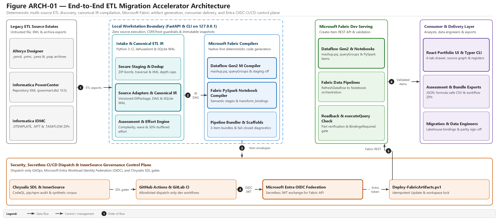

# Microsoft Fabric ETL Migration Accelerator

> **Active InnerSource Collection (`v1.0.0`)** — Deterministic estate discovery, canonical ETL graph assessment, compiler-grounded Microsoft Fabric artifact generation, and secretless CI/CD deployment for migrating **Alteryx Designer**, **Informatica PowerCenter**, and **Informatica IDMC** workloads to **Microsoft Fabric**.

---

## Description

Enterprise customers migrating legacy ETL estates (hundreds to thousands of Alteryx workflows, Informatica PowerCenter repository XML exports, and Informatica IDMC packages) to Microsoft Fabric face manual, error-prone inventorying, inconsistent effort estimation, and unsafe ad-hoc code rewrites.

The **Microsoft Fabric ETL Migration Accelerator** solves these delivery challenges with a deterministic, non-AI compiler and portfolio workbench:

| Capability | Business & Engineering Outcome |
| --- | --- |
| **Multi-Source Discovery & Safety** | Recursively inventories Alteryx (`.yxmd`, `.yxmc`, `.yxwz`, `.yxzp`), Informatica PowerCenter (`powrmart.dtd` XML), and Informatica IDMC export ZIPs with archive-bomb, path-traversal, and `defusedxml` protections plus SHA-256 deduplication—never executing untrusted source content. |
| **Canonical ETL Graph & Effort Model** | Normalizes heterogeneous ETL graphs into a versioned canonical intermediate representation (IR), scoring complexity, wave placement, source/destination registers, and practical residual engineering effort capped at 21 days per workflow. |
| **Compiler-Grounded Fabric Generation** | Compiles supported DAGs natively into **Dataflow Gen2** (`mashup.pq` + `queryMetadata.json`), **Fabric PySpark Notebooks** (`.ipynb`), and **Fabric Data Pipelines** (`pipeline-content.json`), while isolating unsupported operations as explicit, non-deployable `scaffold` diagnostics. |
| **Secretless Dev CI/CD Deployment** | Dispatches pre-existing **GitHub Actions** or **GitLab CI** pipelines authenticating via **Microsoft Entra Workload Identity Federation (OIDC)** to create/update Fabric `dev` items idempotently with definition readback and `executeQuery` validation. |



---

## Getting Started

Take these quick actions depending on your role:

1. **Explore the Architecture & Capabilities**: Read [System Architecture](docs/Architecture/system-architecture.md), [ADR-001: Source Adapters & Canonical ETL IR](docs/Architecture/ADR-001-etl-source-adapters.md), and [Release Notes v1.0.0](docs/Release/release-notes.md).
2. **Run a 5-Minute Synthetic Walkthrough**: Follow the step-by-step [Getting Started Guide](docs/Guides/getting-started.md) using the repository's built-in synthetic Alteryx (`alteryx-workflows/`) and Informatica (`tests/fixtures/`) estates.
3. **Configure Fabric Dev CI/CD**: Follow [Fabric CI/CD Setup](docs/Guides/fabric-ci-cd-setup.md) to connect GitHub Actions or GitLab CI to a Microsoft Fabric `dev` workspace via Entra OIDC.
4. **Ask Questions or Plan a Contribution**: Open a GitHub Issue to propose a new Alteryx plugin or Informatica transformation mapping, and review [`CONTRIBUTING.md`](CONTRIBUTING.md).

---

## Installation and Usage

See [Installation and Runtime Modes](docs/Guides/installation.md) for full workstation, headless CLI, and container instructions.

### Local Analyst Web UI & API

Build the React UI once, then start the loopback FastAPI + UI server:

```powershell
uv sync --extra dev --locked
Set-Location apps\web
npm ci
npm run build
Set-Location ..\..
uv run tool serve
```

Open **`http://127.0.0.1:8050`**:

1. Choose **Alteryx** or **Informatica**, then select files, a `.zip`/`.yxzp` archive, or a local folder. Each assessment scopes one source family at a time; switching workflow family clears the active selection.
2. Review discovered and skipped items, then click **Confirm and assess** (runs against an immutable snapshot using four bounded file workers with cooperative cancellation and SQLite WAL recovery).
3. Use **Portfolio** (and the six-tab workflow drawer or **Technical Details** register — see [Prototype UI Review](docs/Quality/prototype-ui-review.md)) to export JSON/CSV reports, generate Fabric definitions, or download workflow-level deployment ZIP bundles (`generated-fabric-workflows/alteryx-workflows/`, `generated-fabric-workflows/informatica-powercenter/`, and `generated-fabric-workflows/informatica-idmc/`).

### Command-Line Interface (CLI)

```powershell
uv run tool preview .\alteryx-workflows
uv run tool assess .\alteryx-workflows
uv run tool generate <completed-run-id> --target all --output generated-fabric-workflows
```

`assess` emits full assessment JSON (`exit 1` if any workflow fails parsing; `exit 2` on input/configuration rejection). `--target` accepts `dataflow`, `notebook`, `pipeline`, `both` (`dataflow` + `notebook`), or `all`.

### Local Loopback Container

```powershell
docker build -t fabric-etl-accelerator:1.0.0 .
docker run --rm -p 127.0.0.1:8050:8050 -v fabric-etl-state:/data fabric-etl-accelerator:1.0.0
```

> **Important:** Bind the analyst service strictly to `127.0.0.1`. Host/origin validation and CSRF session tokens protect mutating endpoints; UNC paths, symlinks, and reparse points are rejected.

### Local Development & Verification

```powershell
uv run --extra dev ruff check src tests
uv run --extra dev mypy
uv run --extra dev pytest --cov-fail-under=80
uvx pip-audit --strict

Set-Location apps\web
npm run lint
npm test
npm run build
npm audit --audit-level=high
```

---

## Compiler and Deployment Boundaries

- **Alteryx Designer**:
  - **Dataflow Gen2**: Compiles linear and multi-branch DAGs (`InputData`, `DbFileInput`, `TextInput`, `Select`, `Filter`, `Formula`, inner `Join`, `Union`-by-name, `CrossTab` Sum, and multiple terminal outputs). Preserves `ToolContainer` nesting as Fabric `queryGroups` (`parentId` / `queryGroupId`), folds sequential single-branch chains into `let ... in` steps, and sets `computeEngineSettings.allowFastCopy: false` and `loadEnabled: false` across all queries by default.
  - **Fabric Notebook (PySpark)**: Additionally compiles `Sort`, grouped `MultiRow` running totals, `Summarize` (`Sum`/`Count`), field arithmetic, `IIF`, and multiple outputs using semantic annotation variable names and documented source-binding cells.
  - **Mixed Bundles**: Workflows requiring both Dataflow Gen2 and Fabric Notebook emit a three-item bundle (`dataflow-create-item.json`, `notebook-create-item.json`, `pipeline-create-item.json`) sequencing `RefreshDataflow` → `TridentNotebook`.
- **Informatica PowerCenter & IDMC**:
  - **PowerCenter**: Recognizes standalone and zipped `powrmart.dtd` XML (entity expansion forbidden), links reusable and workflow-nested sessions to mappings, and compiles `Source`, `Source Qualifier`, `Filter`, bounded `Expression` (pass-through, trim, date parse/validation, arithmetic, literals, `IIF`, timestamps, file-path parsing), `Router` output/default groups, and `GROUPBY` `Aggregator` stages to Dataflow Gen2 or PySpark Notebooks (`SqlTransformBindings` / `transform_bindings` for custom SQL, Lookup Procedures, Java/custom transforms, and Update Strategy).
  - **IDMC**: Parses IDMC export packages (`.DTEMPLATE`, `.MTT`, `.TASKFLOW`) and compiles taskflow orchestration to Fabric Data Pipelines when multi-step orchestration is required.
- **Explicit Scaffolds & Readiness**: Generated items carry `generated_unvalidated` status (`deployable_definition` indicates structural validity, not semantic parity or bound credentials). Unsupported tools, macros, or multi-mapping workflows emit `*-diagnostics.json` scaffolds only and are excluded from `deployment-plan.json` and `*-create-item.json` envelopes. See [Implementation Plan](docs/Planning/accelerator-implementation-plan.md) and [Local Architecture Decisions](docs/Planning/local-architecture-decisions.md).

---

## CI/CD Deployment

See the [Fabric CI/CD Setup Guide](docs/Guides/fabric-ci-cd-setup.md) and [Deployment Strategy](docs/Release/deployment-strategy.md) for full configuration.

- **GitHub Actions** ([`.github/workflows/deploy-fabric-artifacts.yml`](.github/workflows/deploy-fabric-artifacts.yml)) and **GitLab CI** ([`.gitlab-ci.yml`](.gitlab-ci.yml)) invoke [`scripts/Deploy-FabricArtifacts.ps1`](scripts/Deploy-FabricArtifacts.ps1) in a `dev`-locked environment with per-workspace concurrency serialization.
- **Microsoft Entra OIDC Federation**: Configure `AZURE_CLIENT_ID` and `AZURE_TENANT_ID` with Workload Identity Federation (`id-token: write` / `AZURE_FEDERATED_TOKEN_FILE`); `AZURE_CLIENT_SECRET` is optional fallback only. Supply `FABRIC_WORKSPACE_ID` at dispatch time.
- **Runner Policy**: Standard CI jobs ([`.github/workflows/ci.yml`](.github/workflows/ci.yml)) enforce Ruff, strict mypy, pytest (`>=80%` coverage), Web lint/tests/build, `pip-audit`, `npm audit`, and CodeQL SAST. Jobs default to `["self-hosted", "Windows", "X64"]` for Microsoft EMU compatibility and can target organization runner groups via `vars.CI_RUNNER_LABELS`.
- **Dispatch-Only Backend Integration**: Configure `GITHUB_AUTH_MODE=github-app` (`GITHUB_APP_ID`, `GITHUB_APP_PRIVATE_KEY_PATH`, `GITHUB_ALLOWED_REPOSITORIES`) or `GITLAB_BASE_URL` / `GITLAB_TOKEN` / `GITLAB_ALLOWED_PROJECTS`. Neither integration mutates repository files or reads external logs.
- **Saved-Query Validation**: Because Fabric rejects SPN-triggered Dataflow refresh (`SPNBasedRefreshNotAllowed`), live runs verify definition readback and validate load-enabled queries via `executeQuery` when runtime-ready (or report `BindingsRequired`).

---

## Security Boundary

- **Untrusted Archive & XML Limits**: Enforces caps of `10,000` archive entries, `2 GiB` expanded size (`100 MiB` browser upload), `100 MiB` per workflow, `100:1` compression ratio, one nested `.yxzp` level, `64` XML nesting levels, and `100,000` XML elements.
- **Redacted Evidence & Exports**: `GET /api/runs/{id}/evidence` withholds credential-bearing expressions, and CSV exports defuse spreadsheet formulas. Managed state lives in `.accelerator/` (SQLite WAL with 5-minute lease recovery) outside Git and Docker build contexts.
- Full STRIDE analysis and SDL controls are documented in [Threat Model](docs/Security/threat-model.md) and [`SECURITY.md`](SECURITY.md).

---

## Support

- **Documentation & Troubleshooting**: Check [Troubleshooting](docs/Guides/troubleshooting.md), [Getting Started](docs/Guides/getting-started.md), and [Fabric CI/CD Setup](docs/Guides/fabric-ci-cd-setup.md).
- **Bugs & Enhancement Requests**: Open an issue in this repository using synthetic reproduction fixtures only (never attach customer workflows, tenant/workspace GUIDs, or real data).
- **Chrysalis Portal Feedback**: Submit asset ratings, reuse questions, and realized-value feedback on the asset page in [Chrysalis](https://portal.chrysalis.ms). See [`SUPPORT.md`](SUPPORT.md) for full details.

---

## Contribute

This accelerator follows Microsoft **InnerSource** principles—contributions from field architects, data engineers, and delivery consultants across Microsoft are welcome (including new Alteryx tool compilers, Informatica transformation mappings, Fabric CI/CD enhancements, and documentation improvements).

All contributions use an issue-first, pull-request-reviewed workflow with mandatory synthetic-only test fixtures (`>=80%` Python coverage, strict typing, zero customer data). Read [`CONTRIBUTING.md`](CONTRIBUTING.md) for repository content structure, stakeholder roles, required tooling, and step-by-step PR guidelines.

---

## Core Team

| Name | GitHub / Contact | Focus Areas |
| --- | --- | --- |
| **Chander kant Sharma** | `@chandsharma_microsoft` (`chandsharma@microsoft.com`) | Principal Architecture, Canonical ETL IR, Alteryx & Informatica Compilers, Fabric CI/CD & Governance |

---

## Acknowledgements

- Built for Microsoft Industry Solutions Delivery (ISD) and MCAPS data modernization engagements moving legacy ETL estates to **Microsoft Fabric**.
- Open-source runtime and build libraries used by this accelerator (`FastAPI`, `Pydantic`, `defusedxml`, `Typer`, `React`, `Vite`) are attributed in [`NOTICE.md`](NOTICE.md).

---

## Scope

- **Visibility & Reuse Scope**: **Microsoft Internal Only** (`Internal Only = Yes` in Chrysalis). Available for internal consumption, adaptation, and InnerSource collaboration by authorized Microsoft employees within Microsoft EMU (`mcaps-microsoft`) and Chrysalis.
- **External Distribution**: Must not be published externally or open-sourced without explicit Microsoft Legal and OSPO approval (`https://aka.ms/ospo`). See [`LICENSE`](LICENSE).
