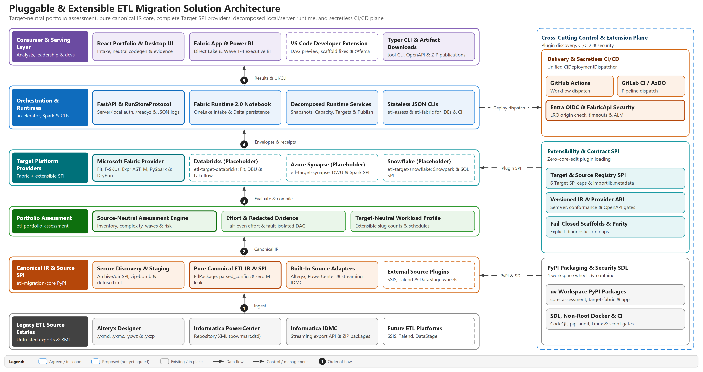
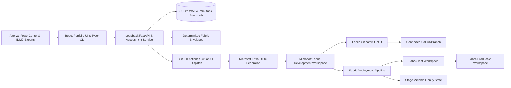
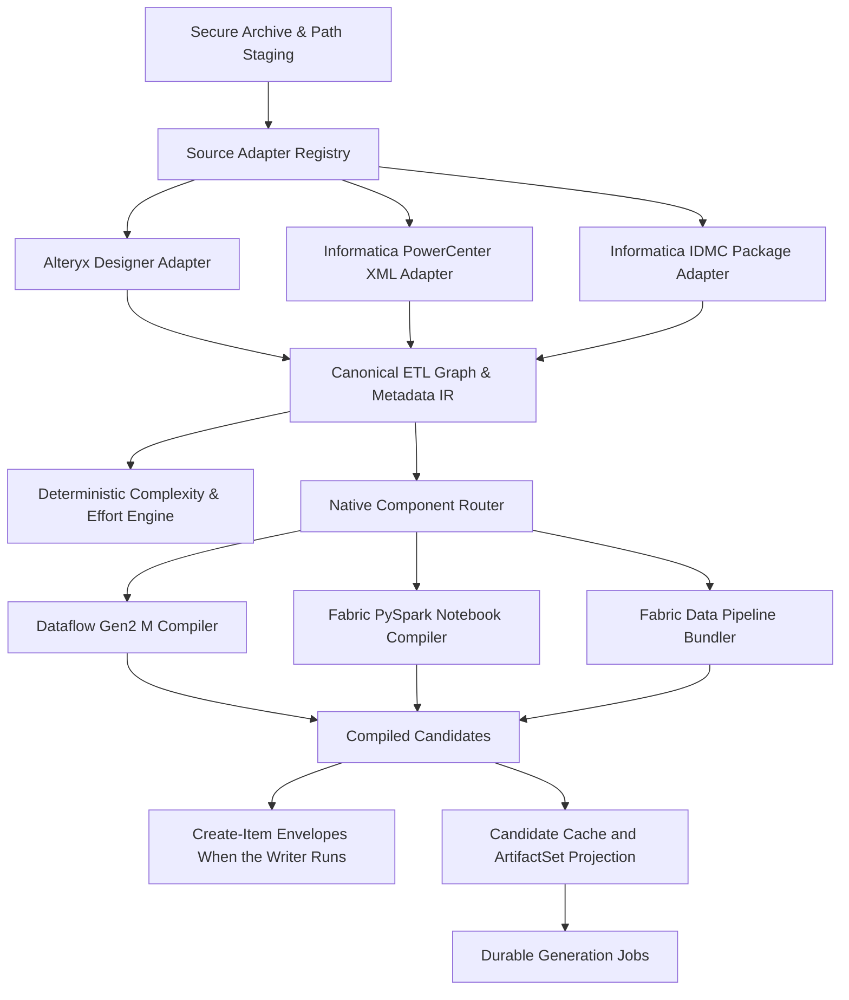

## Overview

This architecture covers the end-to-end component boundaries, canonical
intermediate representation, pluggable target-platform SPI, and deployment
topology of the **Microsoft Fabric ETL Migration Accelerator**.

## Pluggable Package and Extension Architecture

The codebase is organized as a `uv` workspace separating canonical ETL IR, target-neutral portfolio assessment, target-platform providers, and the runtime application shell. In the local React workbench (`apps/web`), portfolio assessment (**Portfolio**) is separated from target-platform selection, Fabric code generation, and GitOps dispatch (**Fabric Deployment**). See [Building Source and Target Plugins](../Guides/building-plugins.md) and the [Pluggable Architecture Implementation Plan](../Planning/pluggable-architecture-implementation-plan.md).

| Package | PyPI distribution | Responsibilities |
| :--- | :--- | :--- |
| Core IR and SPI | `etl-migration-core` | Canonical `EtlPackage` IR, secure staging, source adapters, and `TargetPlatformRegistry` (with fail-closed placeholders for `databricks`, `synapse`, and `snowflake`) |
| Portfolio Assessment | `etl-portfolio-assessment` | Target-neutral complexity, base effort, workload profile, redacted evidence, and stateless `etl-assess` CLI |
| Microsoft Fabric Provider | `etl-target-fabric` | Fabric target evaluator, F-SKU capacity model, Dataflow Gen2 / PySpark / Pipeline compilers, artifact writer, dry-run planner, and stateless `etl-fabric` CLI |
| Application Shell | `fabric-etl-migration-accelerator` | FastAPI loopback API (`/api/targets`, `/api/runs`, generation jobs), SQLite WAL `RunService`, candidate cache, Typer CLI (`tool`), CI dispatchers, and Desktop shell |

## System Context

## Multi-Source Canonical Compiler Pipeline

The cache is not a second writer. Synchronous generate still owns file output.
Preview returns candidates without updating the shared artifact directory.
Generation jobs read and fill the same cache and do not call the artifact
writer.

## Local generation runtime

Completed assessments can be compiled in two ways.

Synchronous `POST /api/runs/{id}/generate` and `POST /api/runs/{id}/previews`
remain the analyst paths. Generate writes the Fabric artifact tree and returns
the candidate list. Preview does not update the shared artifact directory.
`tool generate` is the CLI path for a persisted tree. There is no CLI command
for generation jobs.

`POST /api/runs/{id}/jobs?target=notebook|dataflow|pipeline` returns `202` and
a queued job. `GET /api/runs/{id}/jobs` lists jobs for that run. A completed
job carries candidates and does not write `generated-fabric-workflows`.
`GET /api/runs/{id}/workflows/{index}/candidates` returns one workflow from the
same compiler path. The index is zero-based in the confirmed snapshot. Jobs
accept one target. They do not accept `both` or `all`.

The worker claims a job with a lease epoch, the same fencing pattern used for
assessment runs. A job interrupted five times is failed and must be submitted
again. Disk errors, database errors, and `ValueError` contract failures,
including an unsupported source, fail the job or the synchronous write. One
workflow's unexpected fault becomes a blocked candidate prefixed with
`unexpected generation fault`, and that fault is not cached. Compiler-returned
scaffold and blocked results are cached.

Candidate keys start with `candidate:` and fold the source hash, display path,
platform, target, asset id, and the compiler, IR, graph, and rules versions.
The matching [ArtifactSet](../../packages/etl-migration-core/src/etl_migration_core/contracts/artifacts.py)
JSON is stored under `artifact:` plus that key. `ArtifactSet` carries identity,
validation state, and diagnostics for one workflow and one target kind. Its
`files` collection is empty. [project_candidate](../../src/accelerator/runtime/artifacts.py)
must not create an artifact tree. `write_candidates` remains the Fabric disk
writer.

Schema 7 appends `generation_jobs`. Candidate JSON stays in the existing cache
table. The schema-4 baseline is unchanged, so a database written by the last
release still migrates forward.

Plugin registration calls `require_compatible_spi`. A missing `spi_version`
means `1.0.0`. A declaration that is not compatible with that host version,
including `2.0.0`, fails registration and is reported as a plugin load failure.
Built-in adapters and placeholders keep loading because they omit the
attribute.

## Key Architectural Invariants

1. **Source-Neutral Canonical IR (`ADR-001`)**: Alteryx `.yxmd/.yxmc/.yxwz/.yxzp`, Informatica PowerCenter `powrmart.dtd` XML, and Informatica IDMC export ZIPs normalize into a single versioned `EtlPackage` / `EtlAsset` / `EtlGraph` representation before target routing.
2. **Native-First Target Routing**:
   - **Dataflow Gen2** is selected first when all stages map cleanly to Power Query M (`allowFastCopy: false` and `loadEnabled: false` by default until destinations are bound; Alteryx `ToolContainer` hierarchy maps to `queryGroups`).
   - **Fabric Notebook (PySpark)** is selected when DAG operations require PySpark windowing, complex joins/aggregations, or explicit `transform_bindings` extension hooks.
   - **Data Pipeline** orchestrates multi-item bundles (`RefreshDataflow` → `TridentNotebook`) or IDMC taskflows when cross-item sequencing is required.
3. **Fail-Closed Scaffolds**: Unsupported transformations, macros, or multi-mapping bundles never emit runnable-looking `*-create-item.json` envelopes; they emit explicit `*-diagnostics.json` design evidence.
4. **Dispatch-Only Secretless CI/CD**: The local backend triggers pre-existing `.github/workflows/deploy-fabric-artifacts.yml` or `.gitlab-ci.yml` workflows on allowlisted repositories and authenticates to Fabric `dev` workspaces via **Microsoft Entra Workload Identity Federation (OIDC)** with definition readback and `executeQuery` validation.
5. **Fabric-Authoritative ALM**: GitHub deployments bootstrap Development, Fabric commits validated workspace definitions to the connected branch, and manually approved Deployment Pipeline operations promote adjacent Test and Production stages.
6. **Stage-Specific Configuration**: Variable Library definitions deploy with supported items, while each workspace independently selects and verifies its active value set.
7. Generation jobs cache candidates and do not write files. Synchronous generate and preview remain the file-writing and preview paths. See [ADR-L18](../Planning/local-architecture-decisions.md#adr-l18-cached-generation-jobs-and-neutral-artifact-projection).
8. Plugin registration treats a missing `spi_version` as `1.0.0` and rejects an incompatible declaration before the plugin is marked loaded.

## Quality Attributes (Well-Architected Alignment)

| Pillar | Architectural Control | Verification |
| --- | --- | --- |
| **Security** | `defusedxml` entity/depth caps, archive-bomb budgets, `127.0.0.1` loopback + CSRF token, Entra OIDC, CodeQL + `pip-audit`/`npm audit` | [`docs/Security/threat-model.md`](../Security/threat-model.md) |
| **Reliability** | SQLite WAL, lease-epoch fencing for assessment runs and generation jobs, per-workflow generation fault isolation, idempotent Development deployment, conflict-aware Git synchronization | `tests/test_generation_hardening.py`, `tests/test_delivery.py`, `tests/test_acceptance.py` |
| **Operational Excellence** | Deterministic caching keyed by compiler and rules versions, a sample-estate golden digest, correlation IDs, manual environment approvals, adjacent-stage promotion, and stage-specific value sets | [`docs/Guides/developer-contribution-guide.md`](../Guides/developer-contribution-guide.md), [`docs/Guides/fabric-ci-cd-setup.md`](../Guides/fabric-ci-cd-setup.md) |
| **Performance Efficiency** | Four bounded parallel file workers, SHA-256 deduplication, streaming archive inspection up to `2 GiB` | `tests/test_discovery.py`, `tests/test_assessment.py` |
