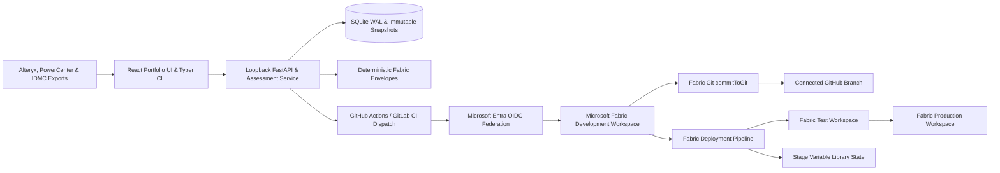
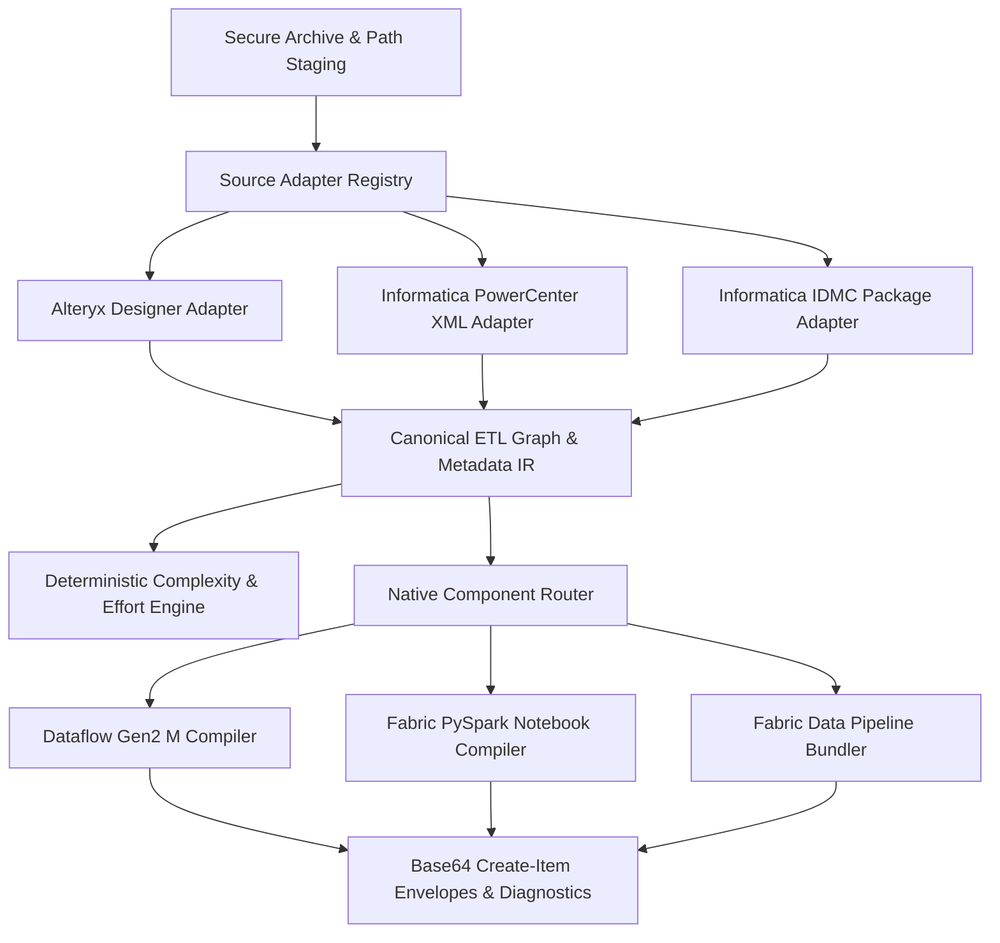

## Overview

This architecture covers the end-to-end component boundaries, canonical
intermediate representation, and deployment topology of the **Microsoft Fabric
ETL Migration Accelerator**.

## Pluggable Package and Extension Architecture

The codebase is organized as a `uv` workspace separating canonical ETL IR, target-neutral portfolio assessment, target-platform providers, and the runtime application shell. See [Building Source and Target Plugins](../Guides/building-plugins.md) and the [Pluggable Architecture Implementation Plan](../Planning/pluggable-architecture-implementation-plan.md).

| Package | PyPI distribution | Responsibilities |
| :--- | :--- | :--- |
| Core IR and SPI | `etl-migration-core` | Canonical `EtlPackage` IR, secure staging, source adapters, and `TargetPlatformRegistry` (with fail-closed placeholders for `databricks`, `synapse`, and `snowflake`) |
| Portfolio Assessment | `etl-portfolio-assessment` | Target-neutral complexity, base effort, workload profile, redacted evidence, and stateless `etl-assess` CLI |
| Microsoft Fabric Provider | `etl-target-fabric` | Fabric target evaluator, F-SKU capacity model, Dataflow Gen2 / PySpark / Pipeline compilers, artifact writer, dry-run planner, and stateless `etl-fabric` CLI |
| Application Shell | `fabric-etl-migration-accelerator` | FastAPI loopback API (`/api/targets`, `/api/runs`), SQLite WAL `RunService`, Typer CLI (`tool`), CI dispatchers, and Desktop shell |

## System Context

## Multi-Source Canonical Compiler Pipeline

## Key Architectural Invariants

1. **Source-Neutral Canonical IR (`ADR-001`)**: Alteryx `.yxmd/.yxmc/.yxwz/.yxzp`, Informatica PowerCenter `powrmart.dtd` XML, and Informatica IDMC export ZIPs normalize into a single versioned `EtlPackage` / `EtlAsset` / `EtlGraph` representation before target routing.
2. **Native-First Target Routing**:
   - **Dataflow Gen2** is selected first when all stages map cleanly to Power Query M (`allowFastCopy: false` and `loadEnabled: false` by default until destinations are bound; Alteryx `ToolContainer` hierarchy maps to `queryGroups`).
   - **Fabric Notebook (PySpark)** is selected when DAG operations require PySpark windowing, complex joins/aggregations, or explicit `transform_bindings` extension hooks.
   - **Data Pipeline** orchestrates multi-item bundles (`RefreshDataflow` → `TridentNotebook`) or IDMC taskflows when cross-item sequencing is required.
3. **Fail-Closed Scaffolds**: Unsupported transformations, macros, or multi-mapping bundles never emit runnable-looking `*-create-item.json` envelopes; they emit explicit `*-diagnostics.json` design evidence.
4. **Dispatch-Only Secretless CI/CD**: The local backend triggers pre-existing `.github/workflows/deploy-fabric-artifacts.yml` or `.gitlab-ci.yml` workflows on allowlisted repositories and authenticates to Fabric `dev` workspaces via **Microsoft Entra Workload Identity Federation (OIDC)** with definition readback and `executeQuery` validation.
5. **Fabric-Authoritative ALM**: GitHub deployments bootstrap Development, Fabric commits validated workspace definitions to the connected branch, and manually approved Deployment Pipeline operations promote adjacent Test and Production stages.
6. **Stage-Specific Configuration**: Variable Library definitions deploy with supported items, while each workspace independently selects and verifies its active value set.

## Quality Attributes (Well-Architected Alignment)

| Pillar | Architectural Control | Verification |
| --- | --- | --- |
| **Security** | `defusedxml` entity/depth caps, archive-bomb budgets, `127.0.0.1` loopback + CSRF token, Entra OIDC, CodeQL + `pip-audit`/`npm audit` | [`docs/Security/threat-model.md`](../Security/threat-model.md) |
| **Reliability** | SQLite WAL, lease-epoch fencing, cooperative batch cancellation, idempotent Development deployment, conflict-aware Git synchronization | `tests/test_delivery.py`, `tests/test_acceptance.py` |
| **Operational Excellence** | Deterministic caching, correlation IDs, manual environment approvals, adjacent-stage promotion, and stage-specific value sets | [`docs/Guides/fabric-ci-cd-setup.md`](../Guides/fabric-ci-cd-setup.md) |
| **Performance Efficiency** | Four bounded parallel file workers, SHA-256 deduplication, streaming archive inspection up to `2 GiB` | `tests/test_discovery.py`, `tests/test_assessment.py` |
