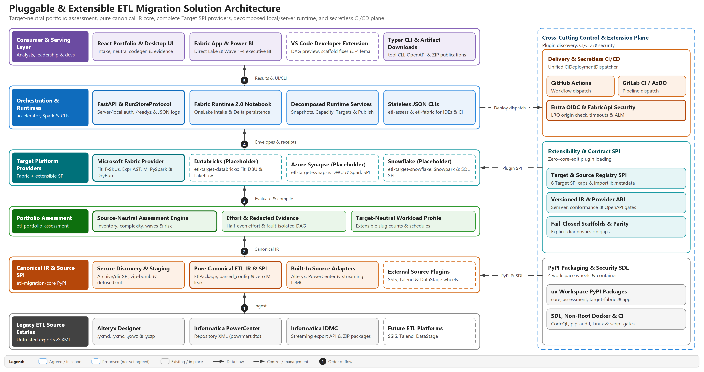

This documentation supports the Microsoft Fabric ETL Migration Accelerator
(FEMA), an internal tool for assessing Alteryx Designer, Informatica
PowerCenter, and Informatica IDMC estates and preparing reviewed migration
artifacts for Microsoft Fabric.

## Choose your path

| If you need to... | Start with... | Then use... |
| --- | --- | --- |
| Assess an estate | [Getting Started](docs/Guides/getting-started.md) | [User Guide](docs/Guides/user-guide.md), [Installation and Runtime Modes](docs/Guides/installation.md) |
| Plan capacity | [Fabric Capacity Planning](docs/Guides/capacity-planning.md) | [User Guide](docs/Guides/user-guide.md) |
| Generate and deploy artifacts | [User Guide](docs/Guides/user-guide.md) | [System Architecture](docs/Architecture/system-architecture.md), [Fabric CI/CD Setup](docs/Guides/fabric-ci-cd-setup.md), [Deployment Strategy](docs/Release/deployment-strategy.md) |
| Fix a bug or add a feature | [Developer Contribution Guide](docs/Guides/developer-contribution-guide.md) | [Contributing](CONTRIBUTING.md) |
| Add a source or target provider | [Building Source and Target Plugins](docs/Guides/building-plugins.md) | [System Architecture](docs/Architecture/system-architecture.md), [ADR-001](docs/Architecture/ADR-001-etl-source-adapters.md) |
| Troubleshoot a local or Fabric run | [Troubleshooting](docs/Guides/troubleshooting.md) | [Installation and Runtime Modes](docs/Guides/installation.md) |
| Understand business scope | [Business Requirements Document](docs/brds/fabric-etl-migration-accelerator-brd.md) | [Pluggable Architecture Business Requirements](docs/Planning/pluggable-architecture-business-requirements.md) |

## Guides

### User workflows

* [Getting Started](docs/Guides/getting-started.md)
* [User Guide](docs/Guides/user-guide.md)
* [Installation and Runtime Modes](docs/Guides/installation.md)
* [Fabric Capacity Planning](docs/Guides/capacity-planning.md)
* [Fabric CI/CD Setup](docs/Guides/fabric-ci-cd-setup.md)
* [Troubleshooting](docs/Guides/troubleshooting.md)

### Developer workflows

* [Developer Contribution Guide](docs/Guides/developer-contribution-guide.md)
* [Building Source and Target Plugins](docs/Guides/building-plugins.md)
* [PyPI Packages and Publishing](docs/Guides/pypi-packages.md)
* [Contributing](CONTRIBUTING.md)

## Product and architecture

* [Business Requirements Document](docs/brds/fabric-etl-migration-accelerator-brd.md)
* [Pluggable Architecture Business Requirements](docs/Planning/pluggable-architecture-business-requirements.md)
* [System Architecture](docs/Architecture/system-architecture.md)
* [ADR-001: Source Adapters and Canonical ETL IR](docs/Architecture/ADR-001-etl-source-adapters.md)
* [Pluggable Architecture Analysis and Target Approach](docs/Planning/pluggable-architecture-analysis-and-approach.md)
* [ETL Modernization Foundation Implementation Plan](docs/Planning/modernization-foundation-implementation-plan.md)
* [Pluggable Architecture Implementation Plan](docs/Planning/pluggable-architecture-implementation-plan.md)
* [Accelerator Implementation Plan](docs/Planning/accelerator-implementation-plan.md)
* [Local Architecture Decisions](docs/Planning/local-architecture-decisions.md)
* [Acceptance Scenarios](specs/features/accelerator.feature)

## Security, quality, and operations

* [Threat Model](docs/Security/threat-model.md)
* [Security Policy](SECURITY.md)
* [Security Scan Results](docs/Quality/security-scan-results.md)
* [Audit Findings Disposition](docs/Quality/audit-findings-log.md)
* [Prototype UI Review](docs/Quality/prototype-ui-review.md)
* [Release Notes](docs/Release/release-notes.md)
* [Deployment Strategy](docs/Release/deployment-strategy.md)
* [Rollback Plan](docs/Release/rollback-plan.md)
* [Support](SUPPORT.md)
* [Third-Party OSS Notice](NOTICE.md)
* [Repository Overview](README.md)
